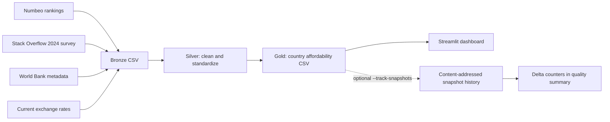

# Data Engineering: Pipeline, Quality and Gold Snapshot Reconciliation

## Architecture

The existing application consumes the same Gold CSV whether or not snapshot
reconciliation is enabled.



The four sources are **full extracts**, not change-data-capture feeds. Numbeo is
queried for a selected ranking year; the Stack Overflow dataset currently stays
fixed to its 2024 developer survey, and exchange rates are fetched at run time.
Consequently, re-running the same Numbeo year on a later day may yield different
USD salaries due to exchange-rate changes. **Do not interpret these differences
as a longitudinal trend in developer purchasing power.**

## Running

Default behavior is unchanged:

```bash
python -m src.pipeline --year 2024
```

To keep an **optional audit of changes between full Gold snapshots**:

```bash
python -m src.pipeline --year 2024 --track-snapshots
```

On successful runs, this creates:

```text
data/snapshots/
  2024/
    latest.json                  # pointer to the newest manifest (overwritten on change)
    log/
      <utc-timestamp>-<id12>.json # immutable manifest per change: id, time, deltas
    history/
      <sha256>.csv                # full snapshot, sorted by ISO3, fixed numeric precision
data/gold/
  country_affordability.csv       # UNCHANGED Streamlit contract
  pipeline_run_summary.json      # optional snapshot statistics when flag is enabled
```

These are **local generated artifacts** and intentionally gitignored. Do not
commit personal, proprietary or unlicensed source data to the repository.

## Reconciliation semantics

- Country identity uses **World Bank ISO3** rather than the display name.
- For a given Numbeo ranking year, each full Gold result is validated (required
  columns, unique nonblank keys, finite numeric values, positive cost index).
- Data is sorted by ISO3 and numeric fields are rounded to eight decimal places
  before content hashing, to avoid changes caused solely by row order.
- The content SHA-256 identifies the full snapshot. Running identical data twice
  produces the same ID and **does not** write a second history file or manifest.
- Every change appends an immutable manifest to `log/`, so the order, timestamps and
  deltas of past versions stay reconstructable; `latest.json` is only a pointer.
- Snapshots live next to the Gold output directory (`<output>/../snapshots`), so
  `--output` is respected.
- A refresh that would remove more than 25% of the previously known countries is
  refused (`max_removed_fraction`, configurable, `None` disables it) because it is
  almost always an ingestion failure rather than a real change.
- Rows are classified as **inserted**, **updated**, **unchanged** or **removed**
  relative to the preceding *snapshot for that same year*.
- A removed country is **not physically deleted from the archived snapshot**;
  the earlier full snapshot remains accessible.
- A missing or corrupted previous snapshot raises an explicit error instead
  of silently replacing historical data.
- Archived files and the pointer manifest use atomic replacement.
- The collection is **not** a database transaction across every CSV and JSON.
  Avoid running concurrent pipeline processes targeting the same snapshot root.

This is **snapshot comparison**, not incremental API ingestion, not a Delta
Lake implementation, and not SCD Type 2. The Bronze and Silver stages still
fetch/process the full source data on each run. It improves auditability and
idempotent history management without changing the dashboard schema.

## Quality and failure behavior

The existing pipeline summary records input, cleaned and Gold row counts,
unmatched countries, currency errors and other quality metrics. When
`--track-snapshots` is enabled, it additionally contains `snapshot` with:

```json
{
  "status": "updated",
  "inserted": 1,
  "updated": 2,
  "unchanged": 91,
  "removed": 1,
  "snapshot_id": "<sha256>",
  "previous_snapshot_id": "<sha256>"
}
```

The numbers above are **illustrative schema values**, not observed execution
metrics. Refer to the generated summary for actual run results.

Snapshots are written **after** the Gold CSV. A snapshot error (corrupted history,
refused mass removal, invalid data) is logged and recorded in the summary as
`"snapshot": {"status": "error", "error": "..."}`, and **does not block** the Gold
output. The Gold CSV is therefore still published when the audit step refuses a
suspicious refresh; inspect `pipeline_run_summary.json` after tracked runs. If you
prefer to block publication instead, validate before `save_gold` and fail the run.

When source fetching fails before Gold is computed, snapshot reconciliation
does not run. The offline test suite includes initial/identical/reordered runs,
added/modified/removed countries, corrupted archives, invalid keys/values,
year isolation, the optional CLI and summary schema.

## Test commands

```bash
python -m pytest -q
ruff check .
```

The tests use in-memory and temporary fixture data; they do not require access
to the source APIs. For changes to Streamlit layout, verify the application
separately.

## Dashboard data source

The Streamlit app reads the real Gold CSV when it exists and otherwise falls back to the
bundled 30-country example. The quality report always comes from the same source: the
example run summary for example data, `pipeline_run_summary.json` for real data (and
no report if that file is missing). A banner states when example data is shown. The
affordability index (salary ÷ cost of living index) is a simplified comparison, not a
full purchasing-power model.
